# 玉莲飞升 · Jade Lotus Ascension

A pixel-art **xianxia RPG** built as a full-stack **Next.js 16** web app. You play **Lin Yue**, a female cultivator of the Azure Cloud Sect. She travels from the floating peaks of her sect to the Crimson Demon Valley to take back the stolen Jade Lotus Heart, rising from *Qi Condensation* to *Immortal Ascension* along the way.

All of the pixel art (characters, beasts, objects and the five parallax backgrounds) is **painted procedurally in TypeScript**. The repo contains no image assets for the game itself. The same painters run in the browser, in Node (for PNG/GIF export) and in unit tests.

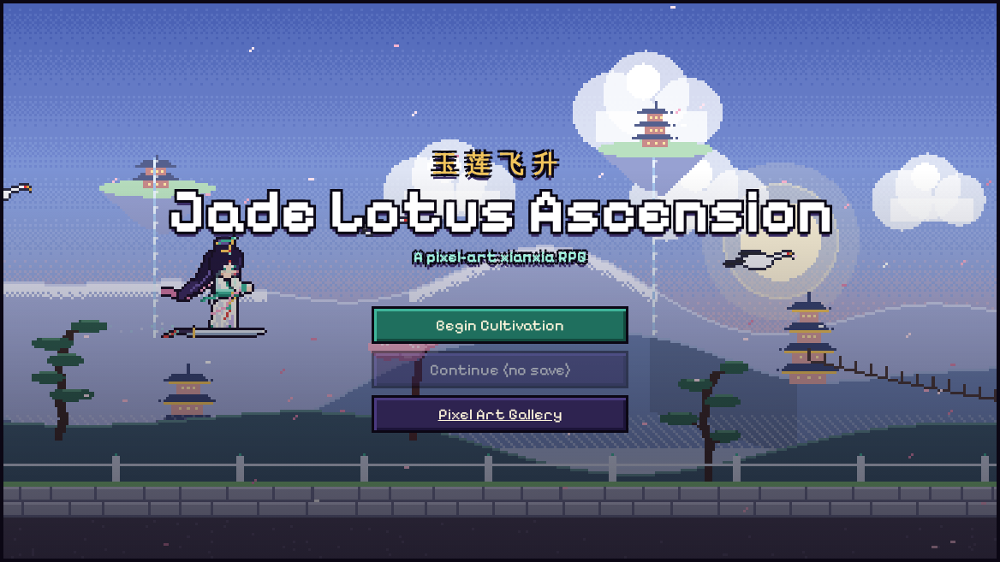

| | |
|---|---|
| 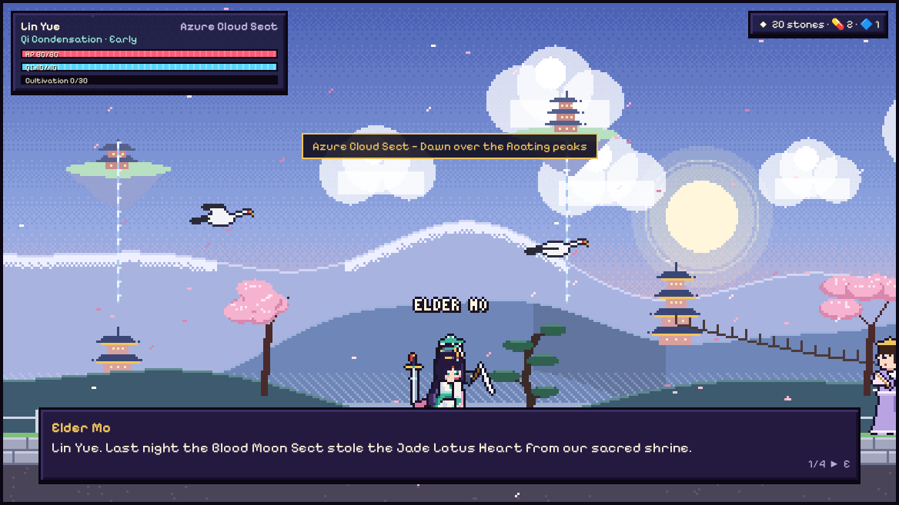 | 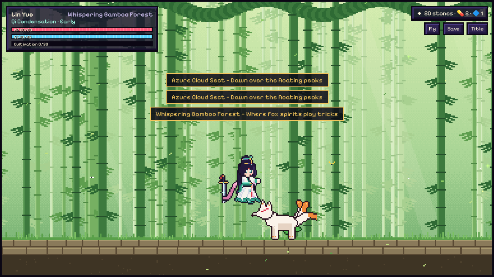 |
| 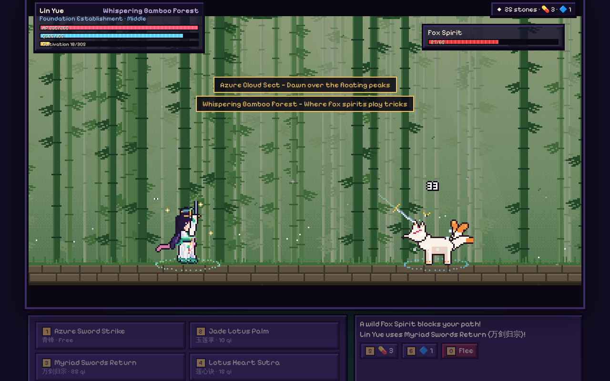 | 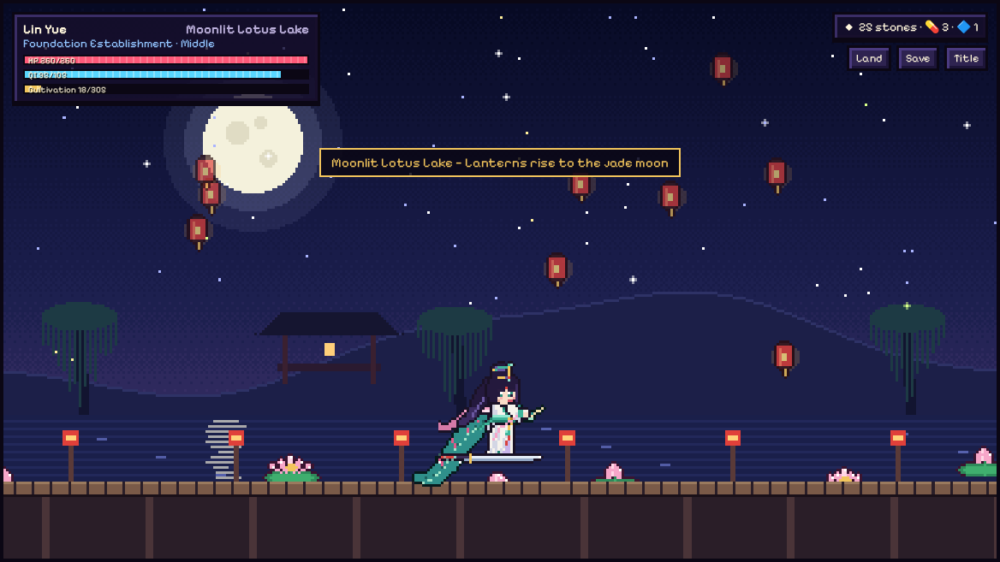 |
| 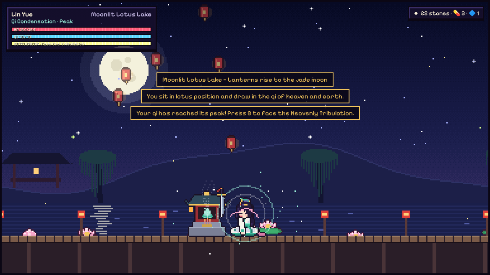 | 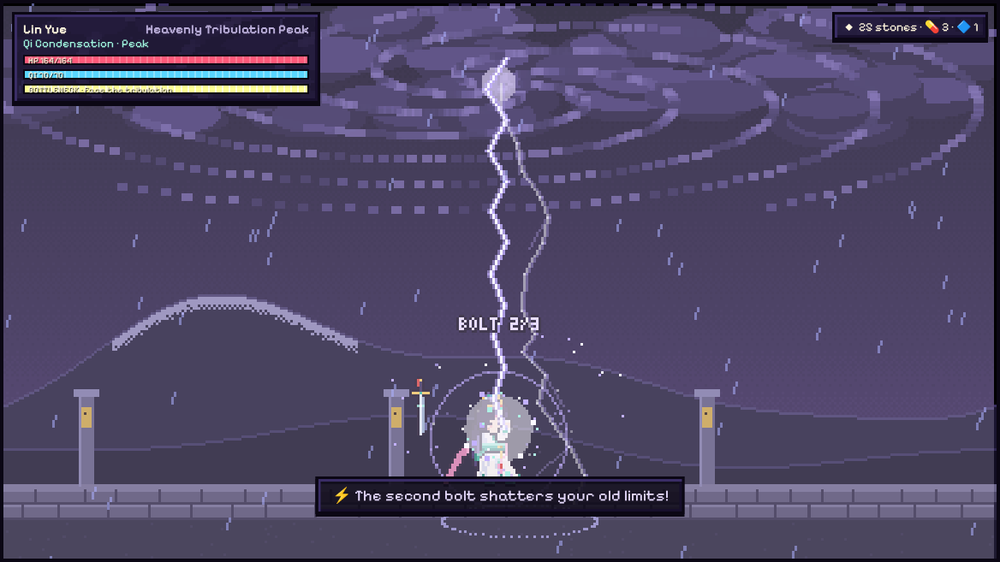 |
| 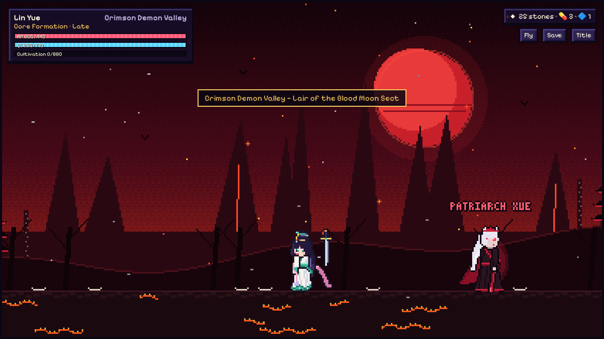 | 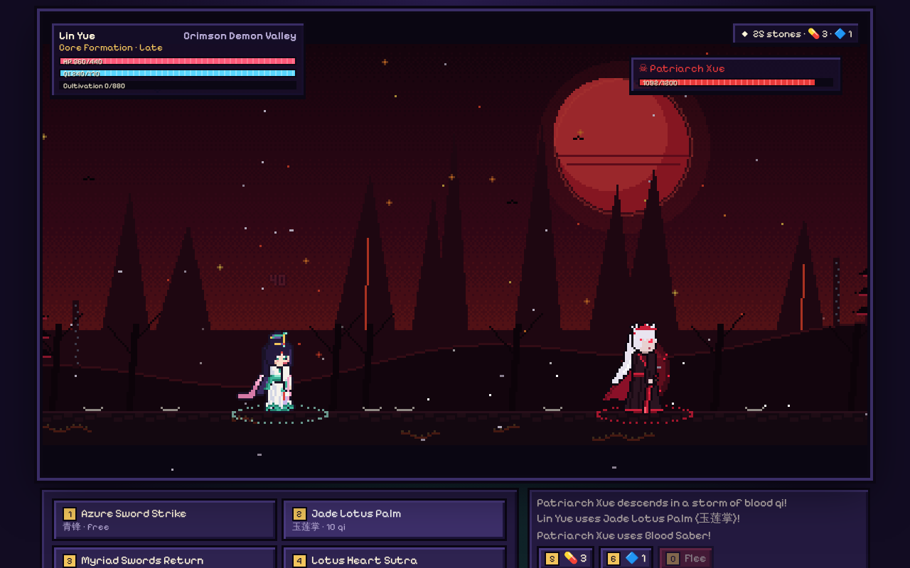 |

### Animated art

| Lin Yue's move set (10 animations) | Bestiary |
|---|---|
| 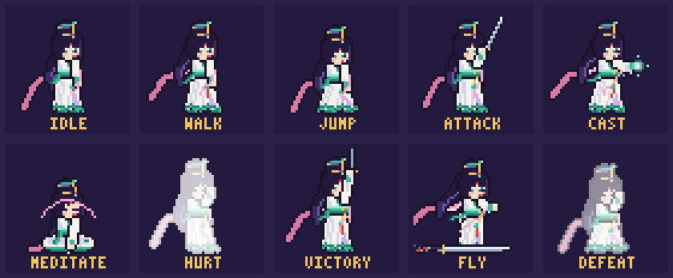 |  |

| NPCs & companion sword | World objects |
|---|---|
| 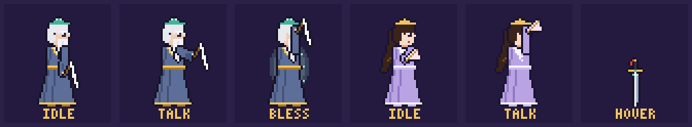 | 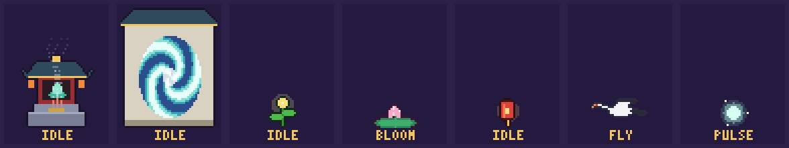 |

| Azure Cloud Sect | Whispering Bamboo Forest | Moonlit Lotus Lake |
|---|---|---|
| 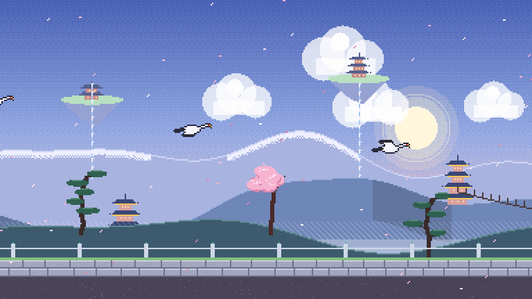 | 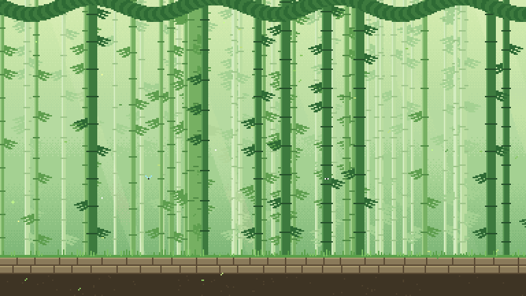 | 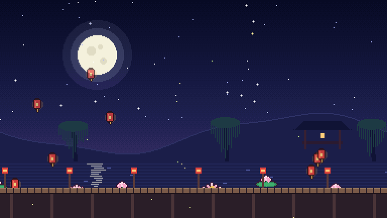 |

| Crimson Demon Valley | Heavenly Tribulation Peak | Title attract mode |
|---|---|---|
| 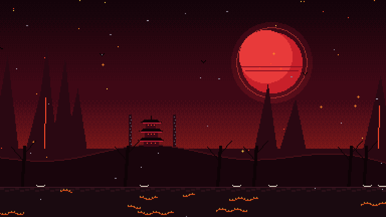 | 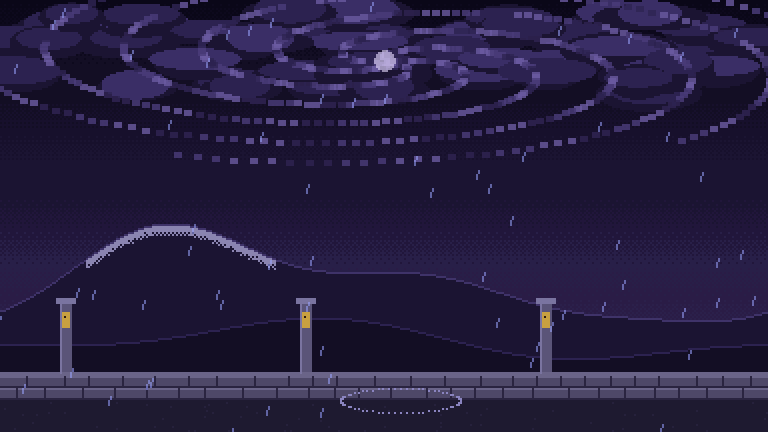 | 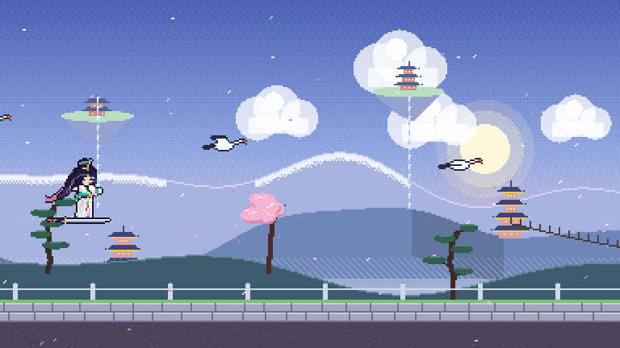 |

## Features

- **Heroine:** Lin Yue has 10 animations: idle (breathing, blinking, swaying hair, shawl and hair ornament), walk, jump, sword attack with a slash arc, qi casting, lotus-position meditation, hurt, victory, flying on her sword, and defeat. Her bonded flying sword follows her around, orbits her while she meditates, and carries her when she flies.
- **Cast:** Elder Mo, Senior Sister Qing (alchemy shop), Patriarch Xue (boss), plus a three-tailed fox spirit, a shadowflame demon wolf, a hopping jiangshi and a jade-scale lake serpent. Each has idle, attack and hurt animations.
- **Five animated parallax realms**, each with time-driven effects:
  - **Azure Cloud Sect:** falling cherry petals, cranes, waterfalls from floating islands
  - **Bamboo Forest:** god rays, fireflies, butterflies
  - **Lotus Lake:** twinkling stars, shooting stars, rising sky lanterns, blooming lotuses, the moon reflected in the water
  - **Demon Valley:** a pulsing blood moon, lava cracks, embers, bats
  - **Tribulation Peak:** a rotating storm vortex, rain and lightning
- **Cultivation system:** 6 realms × 4 stages. Battles, spirit herbs and shrine meditation grow your cultivation. At a realm's peak you hit a bottleneck and must survive a three-bolt **Heavenly Tribulation** cutscene to break through.
- **Turn-based battles** with four techniques (Azure Sword Strike, Jade Lotus Palm, Myriad Swords Return, Lotus Heart Sutra), pills and fleeing. Every action has its own effects: projectiles, flying swords, particle bursts, crit pop-ups, screen shake and flashes.
- **Full stack:** saves are validated with zod and stored server-side by Route Handlers in an atomic JSON file store. A leaderboard of top cultivators is computed from all saves.
- **Art gallery** at `/gallery` shows every sprite animation and backdrop playing live.

## Quick start

```bash
npm install
npm run dev            # http://localhost:3000
```

| Script | What it does |
|---|---|
| `npm run dev` / `build` / `start` | Next.js dev server / production build / production server |
| `npm run lint` · `npm run typecheck` | ESLint (next core-web-vitals + TS) · `tsc --noEmit` |
| `npm test` | Vitest unit tests (pixel core, sprites, scenes, engine, runtime, API) |
| `npm run test:e2e` | Playwright end-to-end tests (needs `npm run build` first) |
| `npm run screenshots` | Re-captures `docs/screenshots/*` through Playwright |
| `npm run assets` | Exports every sprite sheet as PNG and the animated GIF showcases to `docs/art/` |

Saves live in `$DATA_DIR/saves.json` (default `.data/`). Set `SAVE_STORE=memory` for an ephemeral in-memory store, for example on a read-only filesystem.

## Controls

| Key | Action |
|---|---|
| `←` `→` / `A` `D` | Walk |
| `Space` / `↑` | Jump |
| `F` | Ride the flying sword (fast travel; enemies can't reach you) |
| `E` | Talk · travel through moon gates · meditate at lotus shrines |
| `B` | Face the Heavenly Tribulation (at a shrine, when at a bottleneck) |
| `H` / `Q` | Swallow a healing / qi pill |
| `1`–`4` | Battle techniques · `5` `6` pills · `0` flee |

Touch devices get on-screen buttons.

## Architecture

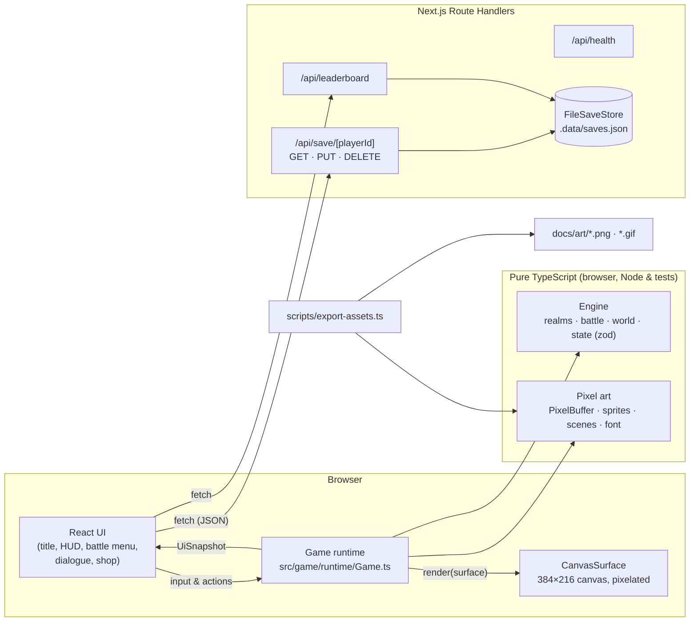

### Game modes

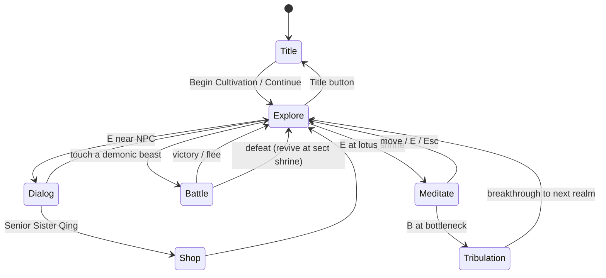

### One battle round

`resolveTurn` is a pure function: it takes the game state, the battle state and an action, and returns the new states plus a list of events. The RNG seed is stored in the battle state, so a round always replays the same way. The runtime turns those events into animations.

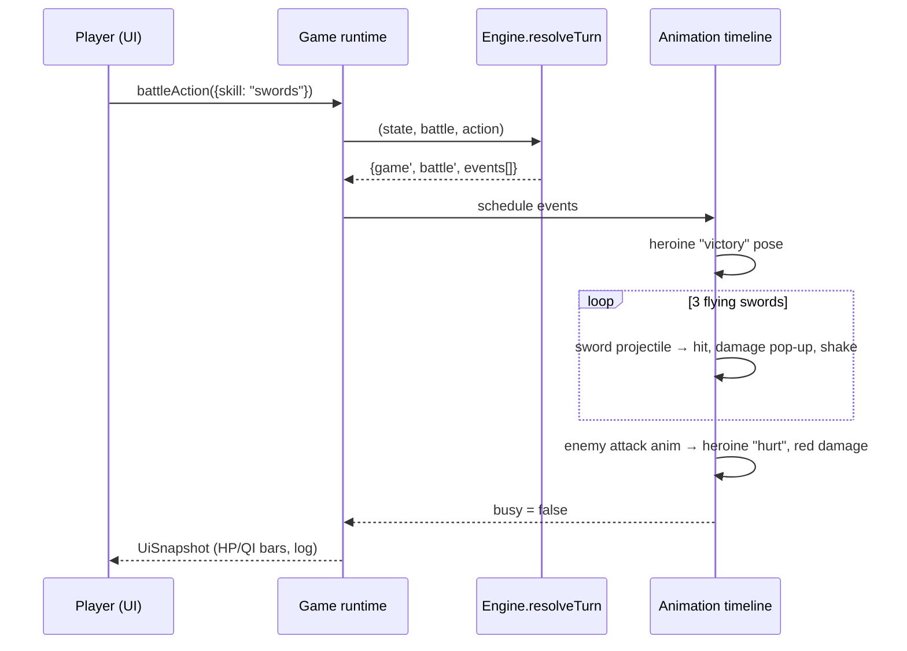

### Cultivation path


Each realm has four stages (Early → Middle → Late → Peak). Stages advance automatically. Moving to a new realm requires the tribulation. Regions are gated by cultivation: Lotus Lake needs *Qi Condensation · Late*, and Demon Valley needs *Foundation Establishment*.

### How the art is made

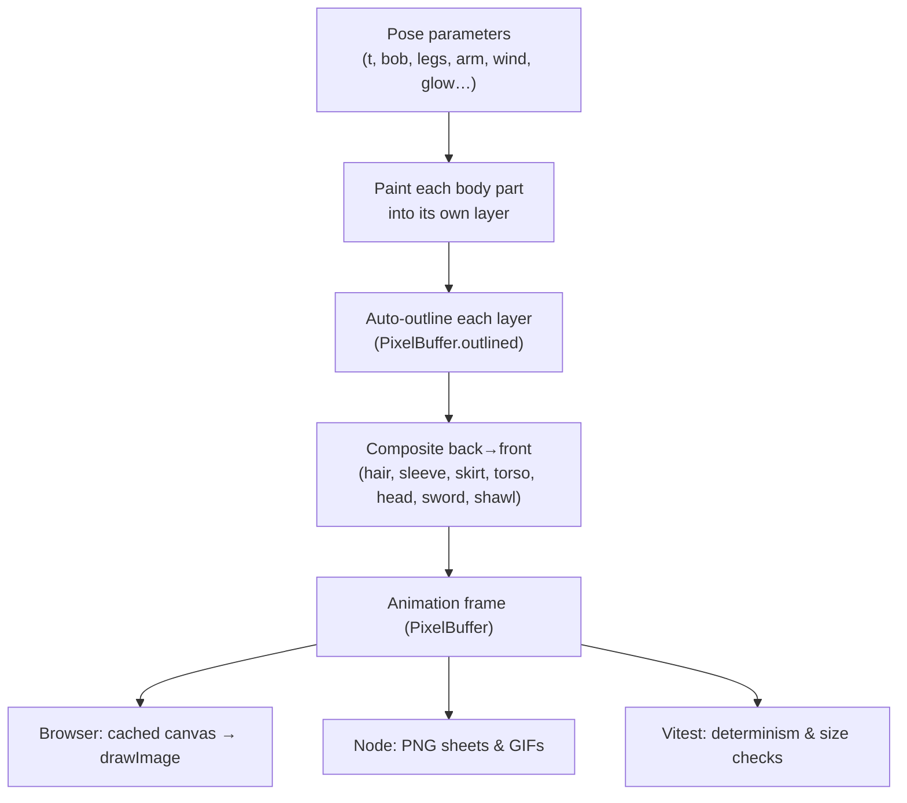

Backgrounds are made of tile-able parallax layers: dithered gradient skies, mountain ridges built from integer-frequency sine waves so they repeat seamlessly, pagodas, pines, bamboo and willows. Particle effects are pure functions of time, so a scene renders the same way live, in a GIF export, or in a snapshot test.

## Testing & CI

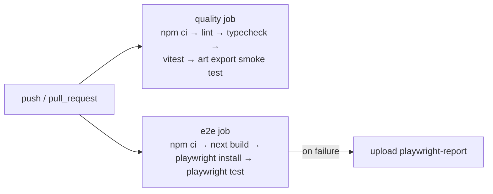

- **Unit tests (Vitest, 68 tests):** colour/PixelBuffer primitives, every sprite sheet (frame sizes, non-empty, deterministic), every scene (fully opaque, deterministic, animates over time), realms, battle and world rules, a headless run of the `Game` runtime (walking, dialogue, a full battle, meditation and tribulation, region gating), and the API route handlers against a temporary file store.
- **E2E (Playwright):** title screen and health check, movement and the elder's dialogue, a battle won through the UI, a save/reload/continue round trip with the leaderboard, and the gallery canvases actually painting.

## Project layout

```
src/
  app/                 Next.js App Router: pages (/, /gallery) + API route handlers
  components/          React UI (GameApp, GameView, SpriteGallery, canvas loop hook)
  game/
    pixel/             PixelBuffer, colour, RNG, 3×5 font, Surface abstraction
    sprites/           heroine, NPCs (figure painter), enemies, world objects
    scenes/            five parallax realms + painting helpers
    engine/            realms, enemies, battle, world, zod save schema (pure)
    runtime/           Game loop, particles, CanvasSurface, title attract mode
  server/              save store (atomic JSON file / memory)
tests/                 Vitest unit tests
e2e/                   Playwright specs (+ screenshot capture)
scripts/               PNG/GIF art export
docs/                  screenshots & exported art
```
