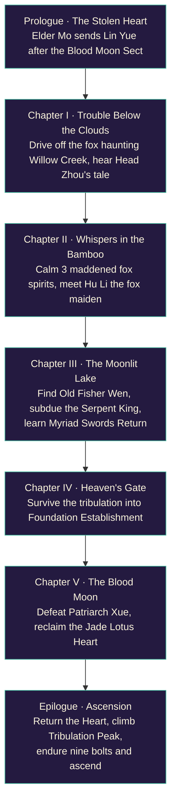
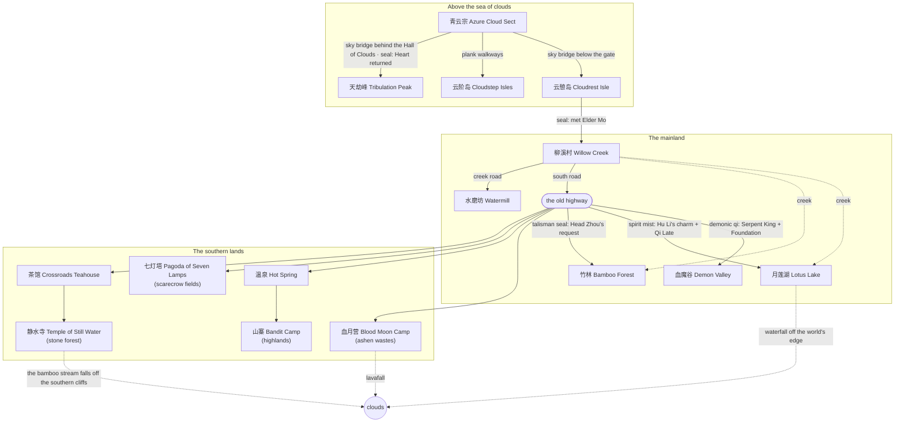
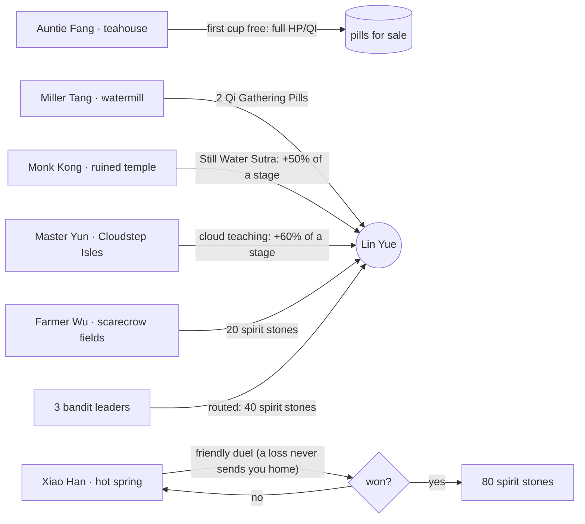
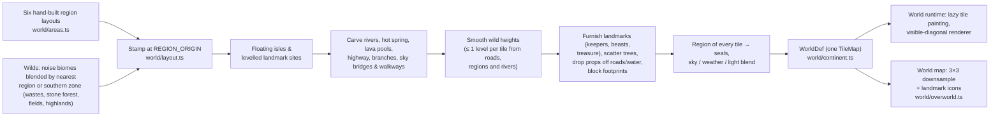
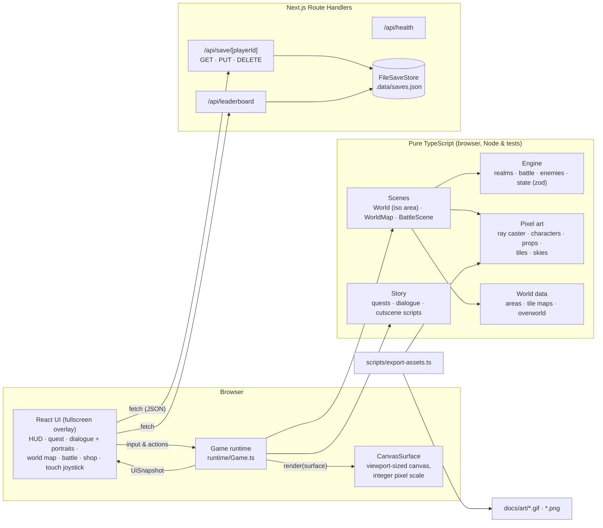
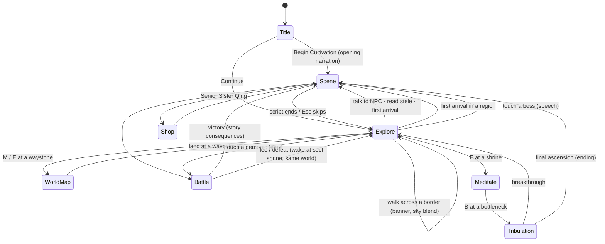
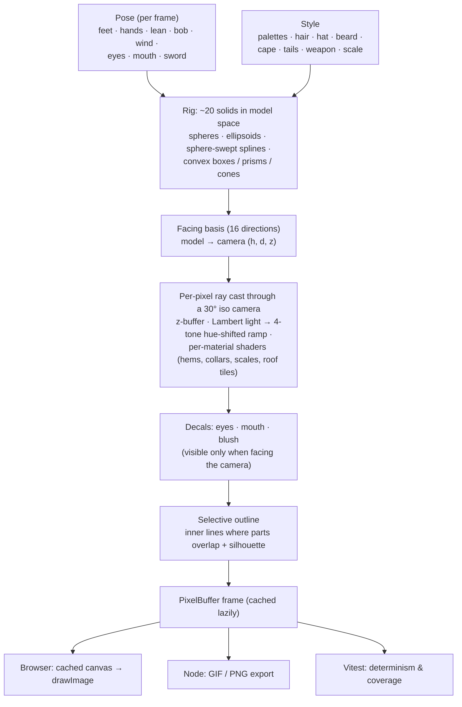
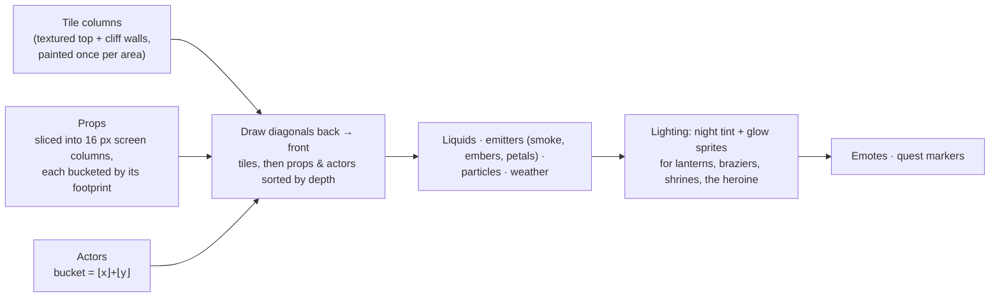
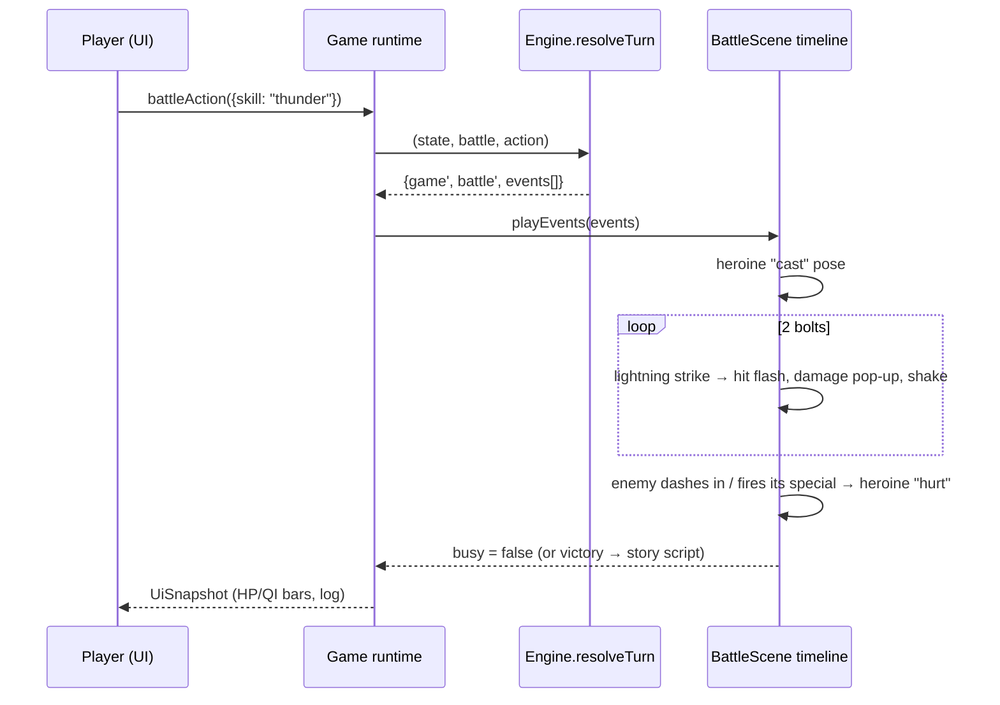
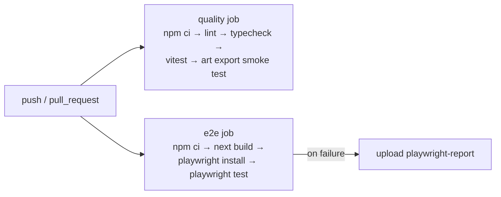

# 玉莲飞升 · Jade Lotus Ascension

A **2.5D isometric pixel-art xianxia RPG** built as a full-stack **Next.js 16** web app. You play **Lin Yue**, an inner disciple of the Azure Cloud Sect. Her journey runs across **one continuous open world**: from the floating sect, down a sky bridge to a mortal village, through a haunted bamboo forest and a moonlit lotus lake, into the Crimson Demon Valley to reclaim the stolen Jade Lotus Heart, and finally up to Heavenly Tribulation Peak, where she rises from *Qi Condensation* to *Immortal Ascension*.

**Every pixel is generated procedurally in TypeScript.** The repo contains no image assets for the game. A small z-buffered ray caster draws characters, beasts, trees and buildings from 3D primitives, which gives every character **16 facing directions** for free. A texture painter draws the isometric terrain. The same code runs in the browser, in Node (PNG/GIF export) and in unit tests. The game fills **100% of the screen** at an integer pixel scale.


### One world, no loading screens

The whole jianghu is a single **324 × 232 tile map** (twice as wide and twice as deep as it used to be). You can walk from the sect gate down a long sky bridge that rests on Cloudrest Isle half way, along the old highway past the bamboo, and on to the waterfall where the Lotus Lake spills off the edge of the world. South of the highway lie the ashen wastes, a stone forest with a ruined temple, scarecrow fields under a seven-tier pagoda and the snowy highlands with a hot spring and a bandit camp. East of the sect, plank walkways lead out to the floating Cloudstep Isles. Sealed regions sit behind walls of mist, talismans, demonic qi or heaven's light until the story opens them.


| | |
|---|---|
|  |  |
|  |  |

### Landmarks of the wilds

Each landmark has its own keeper, beasts and treasure, and its name appears in a banner as you walk up to it.

| | |
|---|---|
|  |  |
|  |  |
|  |  |
|  |  |
|  |  |
|  |  |

| Watermill | Bandit camp | Hot spring |
|---|---|---|
|  |  |  |


| | |
|---|---|
|  |  |
|  |  |
|  |  |
|  |  |
|  |  |
|  |  |
|  |  |

### Animated art

| Lin Yue's 20 animations | All 16 facing directions |
|---|---|
|  |  |

| The cast (turning on the spot) | Bestiary |
|---|---|
|  |  |

| Azure Cloud Sect | Willow Creek Village | Whispering Bamboo Forest |
|---|---|---|
|  |  |  |

| Moonlit Lotus Lake | Crimson Demon Valley | Heavenly Tribulation Peak |
|---|---|---|
|  |  |  |

| World map (a miniature of the real world) | Dialogue portraits |
|---|---|
|  |  |


## Features

- **Continuous open world:** the six regions are stamped into one map, with generated wilds between them (biomes blend at their borders), an old highway with wayside shrines, milestones, lanterns, herbs, chests and roaming beasts, rivers joining the creek, the bamboo stream and the lake, a waterfall and a lavafall off the world's edge, and two sky bridges up to the floating islands. Terrain columns are painted lazily as they come into view, and only the visible diagonals are drawn. Sky, weather, light and tint cross-fade as you walk from one region into the next, and the region banner and first-arrival scene trigger at the border.
- **A living world:** a day/night cycle (stars come out, shooting stars streak past, lanterns glow), dragonflies over the shallows, fireflies rising from the grass after dusk, dandelion seeds on the wind, lava bubbles that swell and pop, birds and bats wheeling overhead, butterflies over meadow flowers, koi leaping in the water, cloud shadows drifting over the land, footprints in sand, snow and ash, cranes that take flight when you come close, NPCs who turn and wave as you pass, a peddler walking the highway with his shop, beasts that shout "!" and gallop after you (and give up with a "?"), and beaten beasts that come back once you've been away for a while.
- **2.5D isometric world:** height-mapped tile maps with cliffs, stairs, raised platforms, floating islands with rocky undersides, animated water and lava with shore foam, depth-sorted props (sliced into screen columns so they occlude correctly), contact shadows, an x-ray silhouette when the heroine walks behind something, and parallax skies.
- **Procedural 3D pixel sprites:** 22 humanoid characters and 6 beasts, each built from roughly 20 ray-cast solids (bell skirts, sleeves, hair strands, shawls, tails, hats, weapons) with hue-shifted 4-tone shading, face decals and selective outlines. They render in 16 directions with up to 20 animations: idle, walk, run, talk, attack, cast, hurt, meditate, sword-flight, victory, defeat, bow, wave, gather (kneel and pick), drink, cheer, point and nod, stretch and look-around idle fidgets, plus hop, practice, fishing, sweeping, dancing and dozing. Foxes and wolves gallop with a run cycle, sniff the ground and curl up asleep with their tails wrapped round them; wolves sit back and howl; cranes peck at the grass. Dialogue portraits are rendered from the same models at 3× scale, with blink and talk frames.
- **Idle life:** villagers and wayfarers break into nods, stretches, sips of tea, little dances and cheers when nobody needs them; sleepers breathe with drifting "Z"s; roaming beasts stop to sniff, howl or nap (and leap up the moment they spot you); Lin Yue drinks her pills and, left alone, nods, points and cheers as well as stretching.
- **50 props, most of them animated:** swaying pines, cherry and maple trees, bamboo groves, willows, a glowing spirit tree, the multi-tier Hall of Clouds, village houses with chimney smoke, a lake pavilion, flickering lanterns and braziers that cast soft glows at night, waving banners, a bubbling alchemy cauldron, bobbing lotuses and boats, a rotating taiji dais, a pulsing blood altar, a turning waterwheel that sheds water, crackling campfires, scarecrows flapping in the wind, a five-tier pagoda with swinging wind chimes, a teahouse with a fluttering tea flag, tents, fluttering prayer flags, steaming hot-spring rocks, karst spires, temple ruins, haystacks and benches.
- **Six regions plus a world map:** the floating Azure Cloud Sect (day, falling petals), Willow Creek Village (dusk, autumn leaves), the Whispering Bamboo Forest (fireflies), the Moonlit Lotus Lake (night, stars and moon), the Crimson Demon Valley (blood moon, embers, lava) and Heavenly Tribulation Peak (snow, storm lightning). The miniature isometric continent has roads, rivers, sea, drifting clouds and their shadows, and animated landmarks. Regions unlock as the story advances.
- **Narrative:** a prologue, five chapters and an epilogue, with a quest tracker, scripted cutscenes (walk, emote, camera, flash, shake, spawn), typed-out dialogue with animated portraits, full-screen narration, first-arrival scenes, pre-boss speeches and an ending.
- **Cultivation:** 6 realms × 4 stages. Battles, spirit herbs, chests and shrine meditation grow your cultivation. At a realm's peak you must survive a Heavenly Tribulation (3 bolts, or 9 for the final ascension).
- **Turn-based battles** on themed isometric arenas, with five techniques (Azure Sword Strike, Jade Lotus Palm, Lotus Heart Sutra, Myriad Swords Return, Nine Heavens Thunder), pills and fleeing. Fighters dash in, recoil, throw qi orbs and foxfire, and call down lightning, with damage pop-ups, crits, screen shake and flashes.
- **Controls:** keyboard, click/tap-to-walk, and a virtual joystick on touch screens.
- **Full stack:** saves are validated with zod and stored server-side by Route Handlers in an atomic JSON file store. A leaderboard of top cultivators is computed from all saves. The gallery at `/gallery` plays every character, prop and region live.

## Quick start

```bash
npm install
npm run dev            # http://localhost:3000
```

| Script | What it does |
|---|---|
| `npm run dev` / `build` / `start` | Next.js dev server / production build / production server |
| `npm run lint` · `npm run typecheck` | ESLint (next core-web-vitals + TS) · `tsc --noEmit` |
| `npm test` | Vitest unit tests (ray caster, art, areas, story, engine, runtime, API) |
| `npm run test:e2e` | Playwright end-to-end tests (needs `npm run build` first; set `PW_CHROMIUM` to use a local Chromium) |
| `npm run screenshots` | Re-captures `docs/screenshots/*` through Playwright |
| `npm run assets` | Exports the animated GIF showcases and PNGs to `docs/art/` |

Saves live in `$DATA_DIR/saves.json` (default `.data/`). Set `SAVE_STORE=memory` for an ephemeral in-memory store. Saves are version 4. Older saves are migrated on load: version 3 positions from the smaller 162 × 116 world keep their place relative to their region, and a position that is no longer open ground (or a save made while flying over water) lands on the nearest open tile.

## Controls

| Key | Action |
|---|---|
| `W A S D` / arrows (or click / tap a tile) | Walk (screen-relative) |
| `Shift` (or push the joystick all the way) | Run |
| `F` | Ride the flying sword (faster, crosses water, enemies can't reach you) |
| `E` / `Space` / `Enter` | Talk · meditate at shrines · open chests · gather herbs · read steles · open the world map at a region's gate |
| `M` | World map of the real world (arrows or clicks pick a region, the sword flies there, `E` lands at its waypoint) |
| `B` | Face the Heavenly Tribulation (while meditating at a bottleneck) |
| `H` / `Q` | Swallow a healing / qi pill |
| `1`–`5` | Battle techniques · `6` `7` pills · `0` flee |
| `Esc` | Skip a cutscene |

## Story



### The world and its seals

Every tile belongs to the nearest region. A sealed region's border shows a wall of mist that the heroine can't cross, even on her sword, until the story lifts it.



### The folk of the wilds

Every keeper has a first meeting with a gift, then rotating small talk. Their beasts and bandits respawn like the rest of the jianghu's.



### How the world is built



## Architecture



### Game modes



### How a sprite is made



### Isometric renderer



### One battle round

`resolveTurn` is a pure function: it takes the game state, the battle state and an action, and returns the new states plus a list of events. The RNG seed lives in the battle state, so a round always replays the same way. `BattleScene` turns those events into a timeline of dashes, projectiles, lightning and pop-ups on an isometric arena themed after the current region.



## Testing & CI



- **Unit tests (Vitest):** the iso projection and ray caster (shading, depth, decal visibility, convex solids), every character × animation × direction, all portraits and props, terrain and skies. Every region layout, and then the whole continuous world, is checked by BFS: every waypoint, NPC, encounter and interactable is reachable on foot, the sky bridges connect, rivers reach the edge, and no prop stands in water or on the road. Also covered: the world map's terrain (built from the real world), save migration from per-region coordinates and from the smaller world, the grown world's size, landmarks and new folk, a complete story walkthrough from prologue to ascension, realms and battle rules, a headless run of the `Game` runtime (cutscenes, walking and collision, tap-to-walk, the elder's briefing, world-map travel, battles won and lost, boss speeches, the fox quest, meditation and tribulation, pickups, rendering every region, walking down the sky bridge into the village, seals turning the heroine back, running, startled cranes, greeting NPCs, respawning beasts, idle fidgets and the day cycle, the wayside folk's gifts, Xiao Han's duel won and lost, landmark banners, beasts sniffing, howling and dozing, opening the map while flying over water, and loading a save onto open ground), and the API route handlers.
- **E2E (Playwright):** fullscreen title and health check, opening narration and walking, walking from the sect into the village in one world, Elder Mo's briefing through to world-map travel, a battle won through the UI, tea and the shop at the crossroads teahouse (with Enter skipping the typewriter text), a save/reload/continue round trip with the leaderboard, and the gallery canvases painting.

## Project layout

```
src/
  app/                 Next.js App Router: pages (/, /gallery) + API route handlers
  components/          React UI (GameApp, GameView, SpriteGallery, canvas loop hook)
  game/
    pixel/             PixelBuffer, colour, noise, RNG, 3×5 font, Surface abstraction
    iso/               isometric projection + z-buffered pixel-art ray caster
    art/               palettes, humanoid & beast rigs, character registry & portraits,
                       props, terrain tiles, skies
    world/             tile maps, the six region layouts, the world layout,
                       the continuous world builder (continent.ts), the world map
    story/             cutscene step types, quests, dialogue, scripted scenes
    engine/            realms, enemies, battle, zod save schema (pure)
    runtime/           Game loop, World (open world + battle arenas), WorldMap, BattleScene, particles, title
  server/              save store (atomic JSON file / memory)
tests/                 Vitest unit tests
e2e/                   Playwright specs (+ screenshot capture)
scripts/               GIF/PNG art export
docs/                  screenshots & exported art
```
