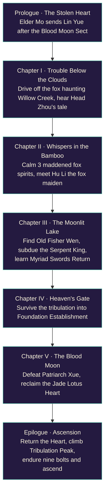
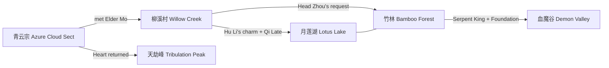
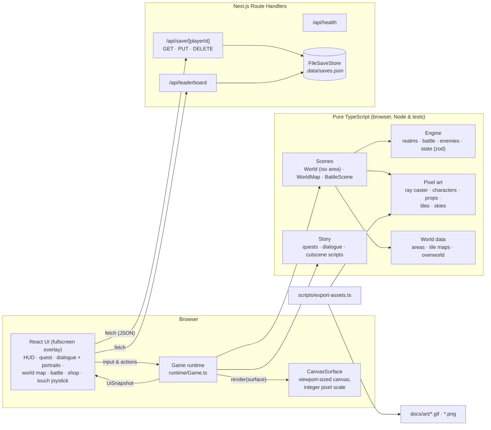
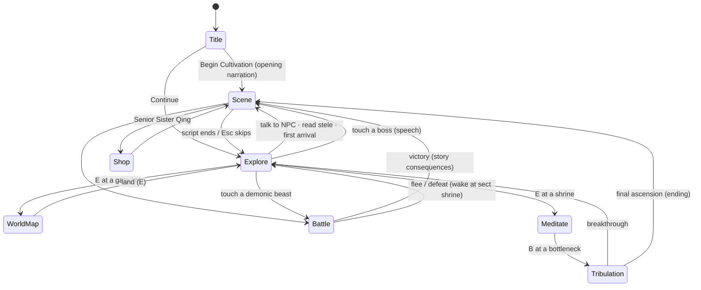
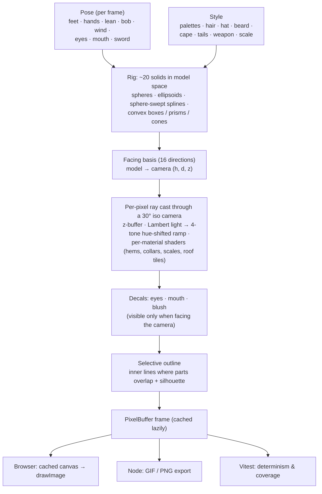
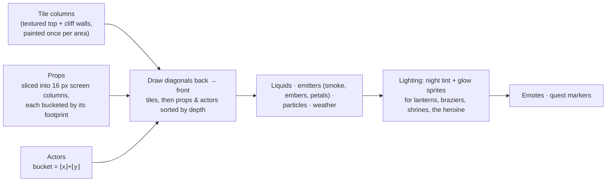
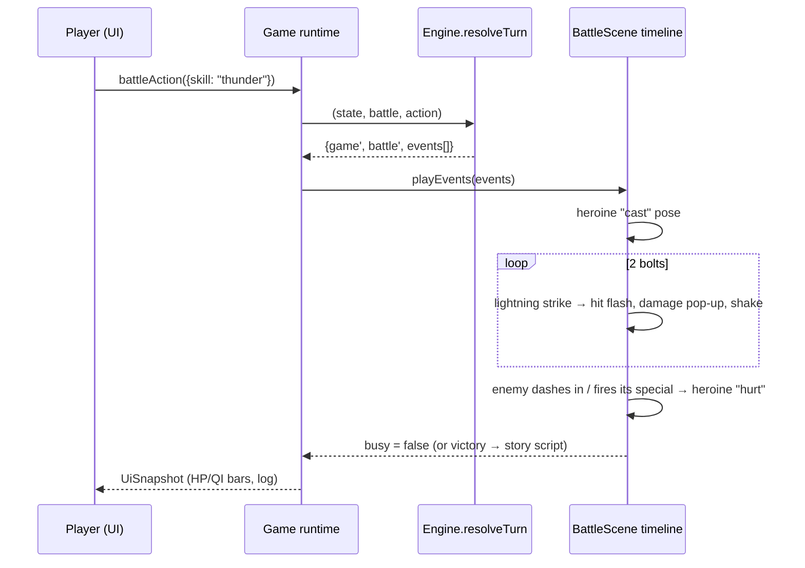
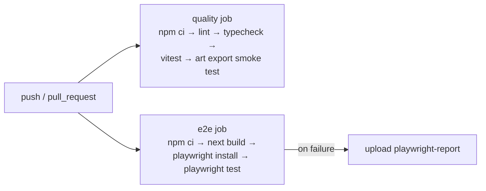

# 玉莲飞升 · Jade Lotus Ascension

A **2.5D isometric pixel-art xianxia RPG** built as a full-stack **Next.js 16** web app. You play **Lin Yue**, an inner disciple of the Azure Cloud Sect. Her journey runs from the floating sect, down to a mortal village, through a haunted bamboo forest and a moonlit lotus lake, into the Crimson Demon Valley to reclaim the stolen Jade Lotus Heart, and finally up to Heavenly Tribulation Peak, where she rises from *Qi Condensation* to *Immortal Ascension*.

**Every pixel is generated procedurally in TypeScript.** The repo contains no image assets for the game. A small z-buffered ray caster draws characters, beasts, trees and buildings from 3D primitives, which gives every character **16 facing directions** for free. A texture painter draws the isometric terrain. The same code runs in the browser, in Node (PNG/GIF export) and in unit tests. The game fills **100% of the screen** at an integer pixel scale.


| | |
|---|---|
|  |  |
|  |  |
|  |  |
|  |  |
|  |  |
|  |  |
|  |  |

### Animated art

| Lin Yue's 11 animations | All 16 facing directions |
|---|---|
|  |  |

| The cast (turning on the spot) | Bestiary |
|---|---|
|  |  |

| Azure Cloud Sect | Willow Creek Village | Whispering Bamboo Forest |
|---|---|---|
|  |  |  |

| Moonlit Lotus Lake | Crimson Demon Valley | Heavenly Tribulation Peak |
|---|---|---|
|  |  |  |

| World map | Dialogue portraits |
|---|---|
|  |  |


## Features

- **2.5D isometric world:** height-mapped tile maps with cliffs, stairs, raised platforms, floating islands with rocky undersides, animated water and lava with shore foam, depth-sorted props (sliced into screen columns so they occlude correctly), contact shadows, an x-ray silhouette when the heroine walks behind something, and parallax skies.
- **Procedural 3D pixel sprites:** 15 humanoid characters and 6 beasts, each built from roughly 20 ray-cast solids (bell skirts, sleeves, hair strands, shawls, tails, hats, weapons) with hue-shifted 4-tone shading, face decals and selective outlines. They render in 16 directions with up to 11 animations: idle, walk, talk, attack, cast, hurt, meditate, sword-flight, victory, defeat and bow, plus hop, practice and fishing. Dialogue portraits are rendered from the same models at 3× scale, with blink and talk frames.
- **38 props, most of them animated:** swaying pines, cherry and maple trees, bamboo groves, willows, a glowing spirit tree, the multi-tier Hall of Clouds, village houses with chimney smoke, a lake pavilion, flickering lanterns and braziers that cast soft glows at night, waving banners, a bubbling alchemy cauldron, bobbing lotuses and boats, a rotating taiji dais, a pulsing blood altar, and more.
- **Six regions plus a world map:** the floating Azure Cloud Sect (day, falling petals), Willow Creek Village (dusk, autumn leaves), the Whispering Bamboo Forest (fireflies), the Moonlit Lotus Lake (night, stars and moon), the Crimson Demon Valley (blood moon, embers, lava) and Heavenly Tribulation Peak (snow, storm lightning). The miniature isometric continent has roads, rivers, sea, drifting clouds and their shadows, and animated landmarks. Regions unlock as the story advances.
- **Narrative:** a prologue, five chapters and an epilogue, with a quest tracker, scripted cutscenes (walk, emote, camera, flash, shake, spawn), typed-out dialogue with animated portraits, full-screen narration, first-arrival scenes, pre-boss speeches and an ending.
- **Cultivation:** 6 realms × 4 stages. Battles, spirit herbs, chests and shrine meditation grow your cultivation. At a realm's peak you must survive a Heavenly Tribulation (3 bolts, or 9 for the final ascension).
- **Turn-based battles** on themed isometric arenas, with five techniques (Azure Sword Strike, Jade Lotus Palm, Lotus Heart Sutra, Myriad Swords Return, Nine Heavens Thunder), pills and fleeing. Fighters dash in, recoil, throw qi orbs and foxfire, and call down lightning, with damage pop-ups, crits, screen shake and flashes.
- **Controls:** keyboard, click/tap-to-walk, and a virtual joystick on touch screens.
- **Full stack:** saves are validated with zod and stored server-side by Route Handlers in an atomic JSON file store. A leaderboard of top cultivators is computed from all saves. The gallery at `/gallery` plays every character, prop and region live.

## Quick start

```bash
npm install
npm run dev            # http://localhost:3000
```

| Script | What it does |
|---|---|
| `npm run dev` / `build` / `start` | Next.js dev server / production build / production server |
| `npm run lint` · `npm run typecheck` | ESLint (next core-web-vitals + TS) · `tsc --noEmit` |
| `npm test` | Vitest unit tests (ray caster, art, areas, story, engine, runtime, API) |
| `npm run test:e2e` | Playwright end-to-end tests (needs `npm run build` first; set `PW_CHROMIUM` to use a local Chromium) |
| `npm run screenshots` | Re-captures `docs/screenshots/*` through Playwright |
| `npm run assets` | Exports the animated GIF showcases and PNGs to `docs/art/` |

Saves live in `$DATA_DIR/saves.json` (default `.data/`). Set `SAVE_STORE=memory` for an ephemeral in-memory store.

## Controls

| Key | Action |
|---|---|
| `W A S D` / arrows (or click / tap a tile) | Walk (screen-relative) |
| `F` | Ride the flying sword (faster, crosses water, enemies can't reach you) |
| `E` / `Space` / `Enter` | Talk · meditate at shrines · open chests · gather herbs · read steles · open the world map at a region's gate |
| `M` | World map (arrows fly along roads, `E` lands) |
| `B` | Face the Heavenly Tribulation (while meditating at a bottleneck) |
| `H` / `Q` | Swallow a healing / qi pill |
| `1`–`5` | Battle techniques · `6` `7` pills · `0` flee |
| `Esc` | Skip a cutscene |

## Story



### World map gating



## Architecture



### Game modes



### How a sprite is made



### Isometric renderer



### One battle round

`resolveTurn` is a pure function: it takes the game state, the battle state and an action, and returns the new states plus a list of events. The RNG seed lives in the battle state, so a round always replays the same way. `BattleScene` turns those events into a timeline of dashes, projectiles, lightning and pop-ups on an isometric arena themed after the current region.



## Testing & CI



- **Unit tests (Vitest):** the iso projection and ray caster (shading, depth, decal visibility, convex solids), every character × animation × direction, all portraits and props, terrain and skies. Every area is checked by BFS for reachability of arrival point, NPCs, encounters and interactables. Also covered: world-map connectivity and terrain, a complete story walkthrough from prologue to ascension, realms and battle rules, a headless run of the `Game` runtime (cutscenes, walking and collision, tap-to-walk, the elder's briefing, world-map travel, battles won and lost, boss speeches, the fox quest, meditation and tribulation, pickups, rendering every region), and the API route handlers.
- **E2E (Playwright):** fullscreen title and health check, opening narration and walking, Elder Mo's briefing through to world-map travel, a battle won through the UI, a save/reload/continue round trip with the leaderboard, and the gallery canvases painting.

## Project layout

```
src/
  app/                 Next.js App Router: pages (/, /gallery) + API route handlers
  components/          React UI (GameApp, GameView, SpriteGallery, canvas loop hook)
  game/
    pixel/             PixelBuffer, colour, noise, RNG, 3×5 font, Surface abstraction
    iso/               isometric projection + z-buffered pixel-art ray caster
    art/               palettes, humanoid & beast rigs, character registry & portraits,
                       props, terrain tiles, skies
    world/             tile maps, the six areas, the overworld
    story/             cutscene step types, quests, dialogue, scripted scenes
    engine/            realms, enemies, battle, zod save schema (pure)
    runtime/           Game loop, World (iso area), WorldMap, BattleScene, particles, title
  server/              save store (atomic JSON file / memory)
tests/                 Vitest unit tests
e2e/                   Playwright specs (+ screenshot capture)
scripts/               GIF/PNG art export
docs/                  screenshots & exported art
```
