# 玉莲飞升 · Jade Lotus Ascension

A **2.5D isometric pixel-art xianxia RPG** built as a full-stack **Next.js 16** web app. You play **Lin Yue**, an inner disciple of the Azure Cloud Sect. Her journey runs across **one continuous open world**: from the floating sect, down a sky bridge to a mortal village, through a haunted bamboo forest and a moonlit lotus lake, into the Crimson Demon Valley to reclaim the stolen Jade Lotus Heart, and finally up to Heavenly Tribulation Peak, where she rises from *Qi Condensation* to *Immortal Ascension*.

**Every pixel is generated procedurally in TypeScript.** The repo contains no image assets for the game. A small z-buffered ray caster draws characters, beasts, trees and buildings from 3D primitives, which gives every character **16 facing directions** for free. A texture painter draws the isometric terrain. The same code runs in the browser, in Node (PNG/GIF export) and in unit tests. The game fills **100% of the screen** at an integer pixel scale.


### One world, no loading screens

The whole jianghu is a single **1296 × 928 tile map**: twice as wide and twice as deep as it was, which was itself twice the world before. The old lands are now its north-western quarter, and **five new regions** lie beyond them (see [The world doubled again](#the-world-doubled-again)). Whistle for **Cloudmane**, Lin Yue's spirit horse, to cover it at a gallop. You can walk from the sect gate down a long sky bridge that rests on Cloudrest Isle half way, along the old highway past the bamboo, and on to the waterfall where the Lotus Lake spills off the edge of the world. South of the highway lie the ashen wastes, a stone forest with a ruined temple, scarecrow fields under a seven-tier pagoda and the snowy highlands with a hot spring and a bandit camp. East of the sect, plank walkways lead out to the floating Cloudstep Isles. Sealed regions sit behind walls of mist, talismans, demonic qi or heaven's light until the story opens them.


| | |
|---|---|
|  |  |
|  |  |

### Landmarks of the wilds

Each landmark has its own keeper, beasts and treasure, and its name appears in a banner as you walk up to it.

| | |
|---|---|
|  |  |
|  |  |
|  |  |
|  |  |
|  |  |
|  |  |

| Watermill | Bandit camp | Hot spring |
|---|---|---|
|  |  |  |


| | |
|---|---|
|  |  |
|  |  |
|  |  |
|  |  |
|  |  |
|  |  |
|  |  |

### Riding Cloudmane

With so much more road to cover, Elder Mo hands Lin Yue a jade whistle along with Sword Riding. Press `R` (or the **Ride** button) and Cloudmane, a white spirit horse with a mane of jade cloud, gallops down out of the sky and rears as she mounts. A canter (7.4 tiles/s) already beats running on foot (5.2), and a gallop with `Shift` (11) is twice as fast as the flying sword (5.6). No beast on the road can keep up with her at a gallop. She swings down from the saddle by herself to talk, read, gather, open a chest, meditate, fight or step through a door, and Cloudmane waits in the clouds while she is indoors. The sword is still the way across water. Herds of wild horses graze the fields, the highlands and the lakeside. They bolt if she comes near on foot, but let a rider among them.

| | |
|---|---|
|  |  |
|  |  |

| Cloudmane and the wild herds | A gallop down the highway |
|---|---|
|  |  |

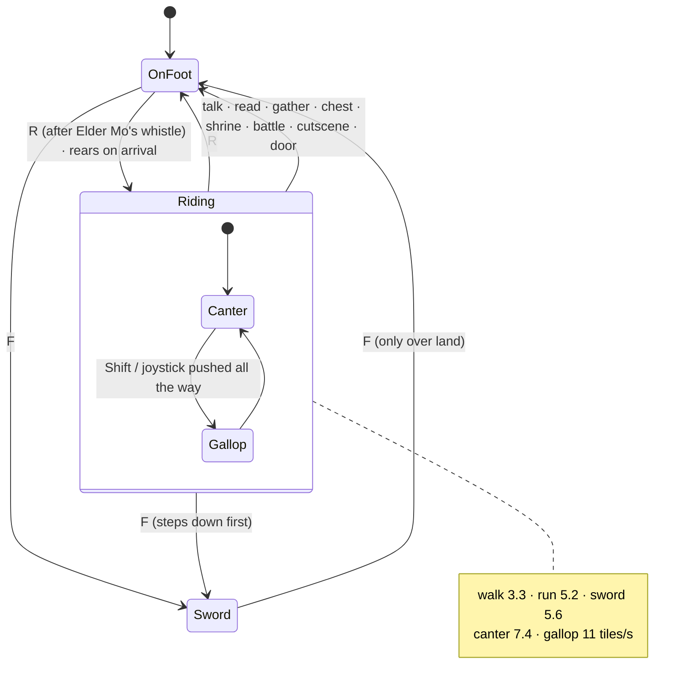

### Step inside

Every building you can enter is **the same size inside as outside**: the room's tile map is exactly the building's footprint in the world, walls included, and the threshold inside lines up with the front door outside. The buildings grew to fit their rooms. The Hall of Clouds and the Pagoda of Seven Lamps are 9 × 9 tiles, and Granny Hua's cottage, the teahouse and the watermill are 8 × 8.

| Outside | Inside |
|---|---|
|  |  |
|  |  |
|  |  |

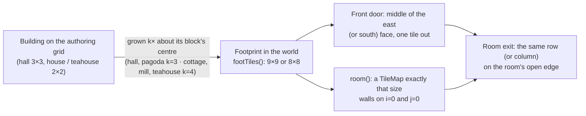

Five buildings open their doors: the **Hall of Clouds** (the sect's ancestral hall and archive), **Granny Hua's cottage** in Willow Creek, the **crossroads teahouse**, the **watermill** and the **Pagoda of Seven Lamps**. Walk into a door (or press `E` on the step) and the world fades into a cutaway room with plastered walls, lattice windows that let shafts of daylight in (with dust turning in them, fading at dusk), lamplight, and furniture that moves: a crackling stove, a loom whose shuttle flies, a millstone turning on its shaft, incense curling off the altars, candles and seven oil lamps flickering on their own rhythms. Each room has its own folk and its own piece of the story.

| | |
|---|---|
|  |  |
|  |  |
|  |  |
|  |  |

| Hall of Clouds | Granny Hua's cottage | Crossroads teahouse |
|---|---|---|
|  |  |  |

| Watermill | Pagoda of Seven Lamps |
|---|---|
|  |  |

### Errands, attire and three new landmarks

The jianghu has more to say. Three new landmarks stand in the wilds, each with its own keeper and story, and four **side errands** run alongside the main quest. They show under the quest tracker as you pick them up, and each ends in a new outfit for Lin Yue. Press `C` (or **Attire**) to change: she twirls into it, and wears it on foot, on Cloudmane, in battle and in her dialogue portrait. Once the Heart is home, Willow Creek holds its first lantern festival in seven years: fireworks burst over the square, the villagers put on their festival best and hold up lanterns, and Little Mei gives her a festival dress.

| | |
|---|---|
|  |  |
|  |  |
|  |  |
|  |  |
|  |  |
|  |  |

| Lin Yue's wardrobe and Willow Creek's festival best | New moves: salute, twirl, hammer, brush, a drifting shade, a lantern |
|---|---|
|  |  |

| Sword Tomb | Moon-Gazing Pavilion (night) | Peach Orchard |
|---|---|---|
|  |  |  |

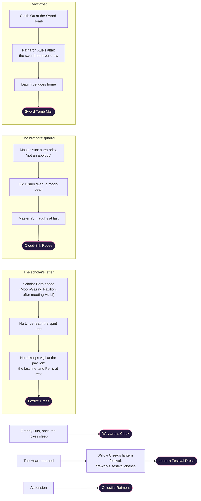

### The world doubled again

The map grew to **1296 × 928 tiles** (four times the area), keeping every old road, landmark and save exactly where it was. The old mainland's southern shore now runs on into **the far south**, and the gorge the Lotus Lake's waterfall pours into is spanned by the **Rainbow Bridge**, which carries the old highway across to **the eastern lands**. Five new regions, each with its own name, sky, weather, light, folk, beasts, shrine and treasure, hold sway over the wilds around them:

- **雾泽 The Mistmarsh** (south-west): stilt houses over black pools, boardwalks, will-o'-wisps, koi, hopping dead and Granny Ye, who knows every frog by name.
- **云雾茶山 Cloudmist Tea Terraces** (south): six terraces climbing into the cloud, rows of tea bushes shivering in the wind, pickers, a porter carrying baskets up and down the steps, and Tea Master Lu, who sold Master Yun his tea brick.
- **黄沙海 The Yellow Sands** (south-east): dunes and red rock, an oasis of fan palms, a caravan camp where Batu plays his flute by the fire, and a stupa older than the sect.
- **浪花港 Wavecrest Harbour** (far east): a whole harbour town of houses, stalls, a noodle cart and a teahouse, junks riding at anchor, fish drying on racks, a lighthouse whose beam sweeps the bay, and the sea itself spilling off the edge of the world.
- **霜幕寺 Frostveil Monastery** (north-east): snow pines and stupas, a great hall at the top of the climb, and monks practising taiji barefoot in the snow.

New biomes fill the land between them (marshland, tea hills, plum blossom hills, sand seas, red badlands, maple woods, the eastern steppe, snowfields and the coast), with broad wandering borders and coastlines, and seven new landmarks: the **Rainbow Bridge**, the **Sect Terraces**, the **Herders' Camp** on the steppe, the **Woodcutters' Lodge**, the **Plum Blossom Shrine**, the **Red Cliff Hideout** of the desert raiders and the **Wayside Inn**. The south road runs on from the pagoda hill to the tea terraces, a stone bridge crosses the lava down into the Mistmarsh, and the southern road links the marsh, the inn, the tea road and the Yellow Sands.

**A busier town and sect.** Willow Creek has three more houses and spills down its market road to the highway under a paifang arch: six more houses, stalls, a noodle cart, a fountain, a woodcutter splitting logs, a porter shouldering his pole, children kicking shuttlecocks and a watchman at the arch. The Azure Cloud Sect is moored to three new floating terraces: the **Disciples' Court** (dormitories, a library pagoda, the well and Cook Pang's noodle cart), the **Taiji Yard** where Elder Qiu leads the morning forms, and the **Sword Garden** with its archery targets. Willow Creek has 16 people now, and the sect 18.

**New moves:** hoeing the dikes, chopping firewood, walking under a carrying pole with two swinging baskets, kicking a feathered shuttlecock, strolling under an oiled-paper umbrella, and slow, flowing taiji, which Lin Yue learns from Elder Qiu and practises by herself when left alone. **New animated props:** junks with stirring sails, a turning lighthouse beam, koi circling in ponds, butterflies over wildflowers, shivering tea bushes, fan palms, snow-laden pines, a fountain with a glittering spout, a war drum that booms and shivers, fish swinging on drying racks, stupas with fluttering prayer flags, a steaming noodle cart and a smoking bronze censer, plus stilt houses, archery targets, handcarts and stacks of wine jars. 17 new characters wear the jianghu's faces, from Captain Hai to Abbot Xuan, and a new side errand, **the Sea-Swallow's peach**, earns the **Sea-Swallow Coat**.

| | |
|---|---|
|  |  |
|  |  |
|  |  |
|  |  |
|  |  |
|  |  |
|  |  |
|  |  |
|  |  |

| Work and play: hoe, axe, carrying pole, shuttlecock, umbrella, taiji | Wavecrest Harbour | Frostveil Monastery |
|---|---|---|
|  |  |  |

| The Mistmarsh | Cloudmist Tea Terraces | The Yellow Sands |
|---|---|---|
|  |  |  |

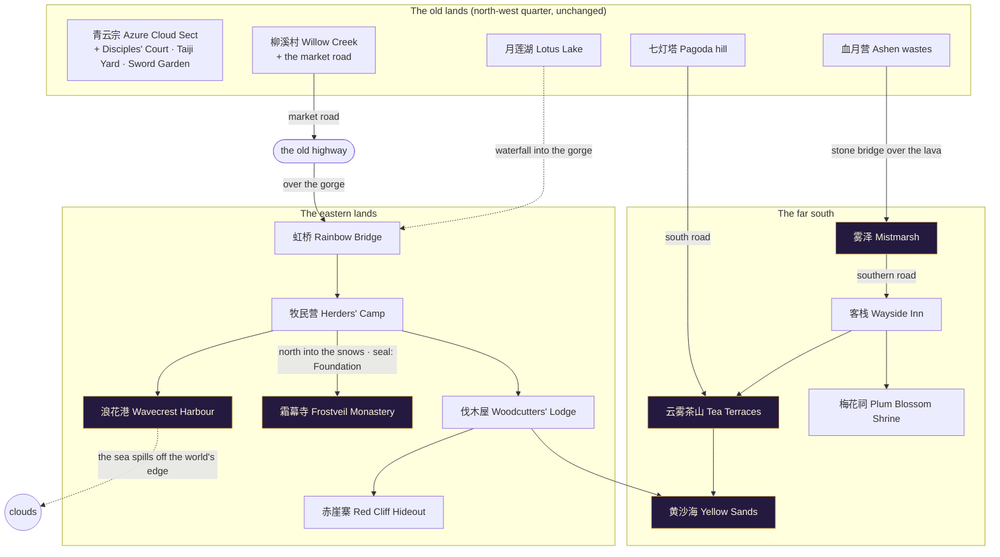

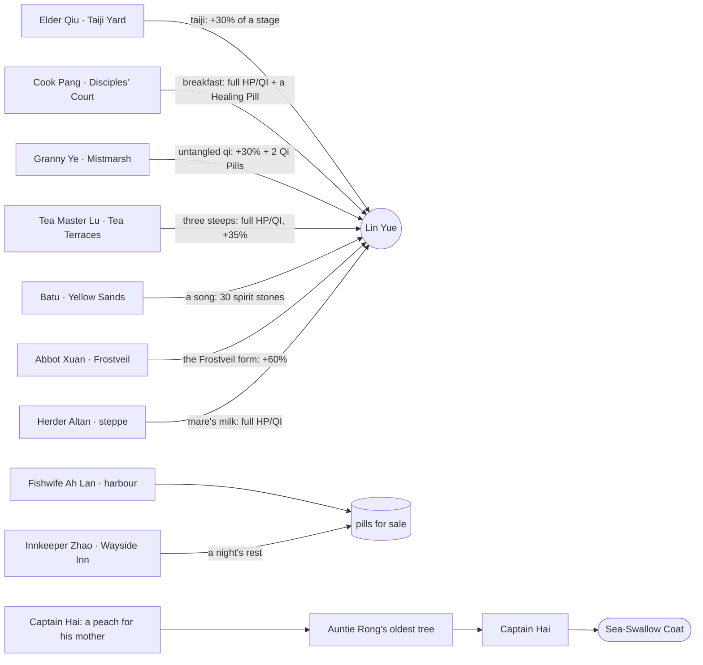

### Animated art

| Lin Yue's 33 animations | All 16 facing directions |
|---|---|
|  |  |

| The cast (turning on the spot) | Bestiary |
|---|---|
|  |  |

| Azure Cloud Sect | Willow Creek Village | Whispering Bamboo Forest |
|---|---|---|
|  |  |  |

| Moonlit Lotus Lake | Crimson Demon Valley | Heavenly Tribulation Peak |
|---|---|---|
|  |  |  |

| Pastimes: the dizi flute, a bowl of noodles, juggling and a fan | Festival lanterns and a kite over Willow Creek |
|---|---|
|  |  |

| World map (a miniature of the real world) | Dialogue portraits |
|---|---|
|  |  |


## Features

- **Continuous open world:** the six regions are stamped into one map, with generated wilds between them (biomes blend at their borders), an old highway with wayside shrines, milestones, lanterns, herbs, chests and roaming beasts, rivers joining the creek, the bamboo stream and the lake, a waterfall and a lavafall off the world's edge, and two sky bridges up to the floating islands. Terrain columns are painted lazily as they come into view, and only the visible diagonals are drawn. Sky, weather, light and tint cross-fade as you walk from one region into the next, and the region banner and first-arrival scene trigger at the border.
- **A living world:** a day/night cycle (stars come out, shooting stars streak past, lanterns glow), dragonflies over the shallows, fireflies rising from the grass after dusk, dandelion seeds on the wind, lava bubbles that swell and pop, birds and bats wheeling overhead, butterflies over meadow flowers, koi leaping in the water, cloud shadows drifting over the land, footprints in sand, snow and ash, cranes that take flight when you come close, NPCs who turn and wave as you pass, a peddler walking the highway with his shop, beasts that shout "!" and gallop after you (and give up with a "?"), and beaten beasts that come back once you've been away for a while.
- **2.5D isometric world:** height-mapped tile maps with cliffs, stairs, raised platforms, floating islands with rocky undersides, animated water and lava with shore foam, depth-sorted props (sliced into screen columns so they occlude correctly), contact shadows, an x-ray silhouette when the heroine walks behind something, and parallax skies.
- **Building interiors:** five cutaway rooms behind real doors in the world, each its own small map run by the same World runtime: back walls with timber frames, wainscots and lattice windows, raised floors with rugs, daylight shafts that follow the day/night cycle, and lamplit furniture. Walking into a door goes through it; walking out over the threshold mat steps back onto the street. Saves made indoors remember the step outside, so a reload lands in the open world. You can't ride your sword or open the world map under a roof.
- **Procedural 3D pixel sprites:** 48 humanoid characters, 7 beasts and a rider on her horse, each built from roughly 20 ray-cast solids (bell skirts, sleeves, hair strands, shawls, tails, hats, weapons) with hue-shifted 4-tone shading, face decals and selective outlines. They render in 16 directions with up to 33 animations: idle, walk, run, talk, attack, cast, hurt, meditate, sword-flight, victory, defeat, bow, wave, gather (kneel and pick), drink, cheer, point and nod, stretch and look-around idle fidgets, plus hop, practice, fishing, sweeping, dancing and dozing, and the everyday ones: reading (with a page turn), sitting, kneeling in prayer, weaving at a loom, pouring tea, clapping, laughing, a seated storyteller's sweeping gestures, and four pastimes: playing the dizi flute (with a few notes over her head), eating a bowl of noodles, juggling three bright balls and cooling off with a folding fan; and the newest: the cultivator's fist-in-palm salute, a twirl on the spot that flares the skirts, a smith's hammer ringing on the anvil, kneeling to write with a brush, a restless shade drifting above the ground, and holding up a festival lantern; and the doubled world's: hoeing, chopping firewood, walking under a carrying pole, kicking a shuttlecock, strolling under an oiled-paper umbrella and slow taiji. People can change clothes: every humanoid can wear **outfits** (style overrides painted and cached per outfit, on foot, on horseback, in battle and in their portrait). Horses walk, gallop, graze and rear, and Lin Yue rides one: horse and rider are painted into one depth buffer so they occlude each other properly. Foxes and wolves gallop with a run cycle, sniff the ground and curl up asleep with their tails wrapped round them; wolves sit back and howl; cranes peck at the grass. Dialogue portraits are rendered from the same models at 3× scale, with blink and talk frames.
- **Idle life:** villagers and wayfarers break into nods, stretches, sips of tea, pours from the teapot, claps, laughs, little dances and cheers when nobody needs them; sleepers breathe with drifting "Z"s; roaming beasts stop to sniff, howl or nap (and leap up the moment they spot you); Lin Yue drinks her pills, reads the steles she stops at, bows in prayer at altars and, left alone, nods, points, claps and laughs as well as stretching, and in the end sits down where she stands until you move her again. Fish shadows glide in slow circles under the water, and washing flaps on a line in Willow Creek.
- **98 props, 61 of them animated** (buildings grow with the world, drawn 2–4× their size and painted only when first seen): swaying pines, cherry and maple trees, bamboo groves, willows, a glowing spirit tree, the multi-tier Hall of Clouds, village houses with chimney smoke, a lake pavilion, flickering lanterns and braziers that cast soft glows at night, waving banners, a bubbling alchemy cauldron, bobbing lotuses and boats, a rotating taiji dais, a pulsing blood altar, a turning waterwheel that sheds water, crackling campfires, scarecrows flapping in the wind, a five-tier pagoda with swinging wind chimes, a teahouse with a fluttering tea flag, tents, fluttering prayer flags, steaming hot-spring rocks, karst spires, temple ruins, haystacks and benches; and indoors, bookcases, hanging scrolls that stir in the draught, a brick stove with a fire and a steaming wok, a loom, a millstone with its crown wheel, grain sacks, ancestral altars with incense and candles, a bronze tree of seven oil lamps, a jade founder's statue, folding screens, a bed, an herb-drying rack, porcelain vases, a sword rack, tea tables with steaming cups, cushions and a washing line; and new: strings of festival lanterns swinging over the village square and the crossroads, bronze temple bells that swing now and then in their bell-frames, and a paper kite riding the wind over Willow Creek; and newest: a village forge with breathing bellows and a red-hot blade on the anvil, the Sword Tomb bristling with glinting blades, peach trees in blossom and fruit that shed petals, straw beehives with bees looping round them, a lonely grave with a stick of incense, drifting will-o'-wisps, and festival fireworks that climb and burst over Willow Creek once the Heart is home (props can now appear only while a story condition holds); and for the doubled world: junks at anchor, a lighthouse with a turning beam, circling koi, butterflies, tea bushes, fan palms, snow pines, a fountain, a war drum, fish-drying racks, stupas, a noodle cart, a bronze censer, stilt houses, archery targets, handcarts and wine jars. Little dust devils (and whirls of ash and sand) spin along the roads.
- **Eleven regions plus a world map:** the five new ones of the doubled world (the Mistmarsh, the Cloudmist Tea Terraces, the Yellow Sands, Wavecrest Harbour and Frostveil Monastery), and the floating Azure Cloud Sect (day, falling petals), Willow Creek Village (dusk, autumn leaves), the Whispering Bamboo Forest (fireflies), the Moonlit Lotus Lake (night, stars and moon), the Crimson Demon Valley (blood moon, embers, lava) and Heavenly Tribulation Peak (snow, storm lightning). The miniature isometric continent has roads, rivers, sea, drifting clouds and their shadows, and animated landmarks. Regions unlock as the story advances.
- **Narrative:** a prologue, five chapters and an epilogue, with a quest tracker, scripted cutscenes (walk, emote, camera, flash, shake, spawn), typed-out dialogue with animated portraits, full-screen narration, first-arrival scenes, pre-boss speeches and an ending; plus four side errands shown under the quest tracker (a ghost's unfinished letter, two quarrelling brothers, a sword brought home, a dead husband's cloak) and Willow Creek's lantern festival, each ending in a new outfit.
- **Cultivation:** 6 realms × 4 stages. Battles, spirit herbs, chests and shrine meditation grow your cultivation. At a realm's peak you must survive a Heavenly Tribulation (3 bolts, or 9 for the final ascension).
- **Turn-based battles** on themed isometric arenas, with five techniques (Azure Sword Strike, Jade Lotus Palm, Lotus Heart Sutra, Myriad Swords Return, Nine Heavens Thunder), pills and fleeing. Fighters dash in, recoil, throw qi orbs and foxfire, and call down lightning, with damage pop-ups, crits, screen shake and flashes.
- **Controls:** keyboard, click/tap-to-walk, and a virtual joystick on touch screens.
- **Full stack:** saves are validated with zod and stored server-side by Route Handlers in an atomic JSON file store. A leaderboard of top cultivators is computed from all saves. The gallery at `/gallery` plays every character, prop and region live.

## Quick start

```bash
npm install
npm run dev            # http://localhost:3000
```

| Script | What it does |
|---|---|
| `npm run dev` / `build` / `start` | Next.js dev server / production build / production server |
| `npm run lint` · `npm run typecheck` | ESLint (next core-web-vitals + TS) · `tsc --noEmit` |
| `npm test` | Vitest unit tests (ray caster, art, areas, story, engine, runtime, API) |
| `npm run test:e2e` | Playwright end-to-end tests (needs `npm run build` first; set `PW_CHROMIUM` to use a local Chromium) |
| `npm run screenshots` | Re-captures `docs/screenshots/*` through Playwright |
| `npm run assets` | Exports the animated GIF showcases and PNGs to `docs/art/` (add `-- docs/art --overview` for the picture of the whole world) |

Saves live in `$DATA_DIR/saves.json` (default `.data/`). Set `SAVE_STORE=memory` for an ephemeral in-memory store. Saves are version 5; the world doubled again around the old lands without moving them, so every version 5 position is still the same spot. Older saves are migrated on load: version 4 positions from the 324 × 232 world are doubled into the magnified world, version 3 positions from the smaller 162 × 116 world keep their place relative to their region, and a position that is no longer open ground (or a save made while flying over water) lands on the nearest open tile.

## Controls

| Key | Action |
|---|---|
| `W A S D` / arrows (or click / tap a tile) | Walk (screen-relative) |
| `Shift` (or push the joystick all the way) | Run |
| `F` | Ride the flying sword (crosses water, enemies can't reach you) |
| `R` | Whistle for Cloudmane, your spirit horse (`Shift` to gallop; `R` again to dismount) |
| `C` | Change attire (once someone has given you something to wear) |
| `E` / `Space` / `Enter` | Talk · meditate at shrines · open chests · gather herbs · read steles · enter and leave buildings · open the world map at a region's gate |
| `M` | World map of the real world (arrows or clicks pick a region, the sword flies there, `E` lands at its waypoint) |
| `B` | Face the Heavenly Tribulation (while meditating at a bottleneck) |
| `H` / `Q` | Swallow a healing / qi pill |
| `1`–`5` | Battle techniques · `6` `7` pills · `0` flee |
| `Esc` | Skip a cutscene |

## Story

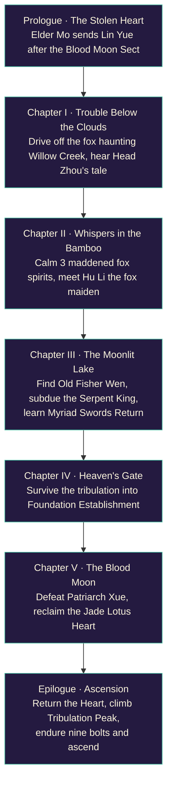

### The world and its seals

Every tile belongs to the nearest region; the five new regions also hold the wider country around them (the steppe and the coast answer to Wavecrest Harbour, the snowfields to Frostveil, the sand seas and badlands to the Yellow Sands). The Mistmarsh and the tea terraces open once Elder Mo has sent her down the mountain, the Yellow Sands and the harbour once Willow Creek is safe, and Frostveil's cold turns her back until Foundation Establishment. A sealed region's border shows a wall of mist that the heroine can't cross, even on her sword, until the story lifts it.


### The folk of the wilds

Every keeper has a first meeting with a gift, then rotating small talk. Their beasts and bandits respawn like the rest of the jianghu's.

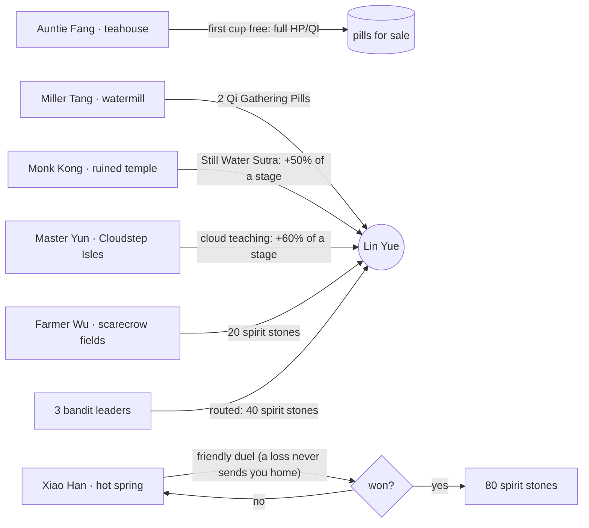

### Doors, rooms and the lore inside

Each building's door is an interactable on the open-world tile in front of it, and each room is a tiny `AreaDef` of its own. Behind the doors the jianghu's history comes out: who the founder was, why the sect floats, what the Heart really is, the war of the Blood Moon two hundred years ago, and the boy from Willow Creek who became Patriarch Xue.


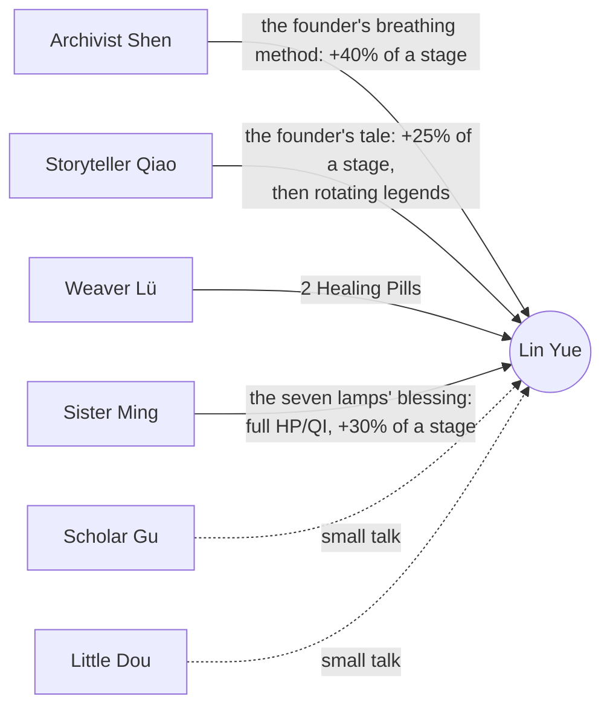

### How the world is built

```mermaid
flowchart LR
  A["Eleven hand-built region layouts<br/>world/areas.ts"] --> S["Stamp at REGION_ORIGIN<br/>world/layout.ts"]
  N["Wilds: noise biomes blended by nearest<br/>region or southern zone (wastes, stone forest,<br/>fields, highlands)"] --> S
  S --> I["Floating isles &<br/>levelled landmark sites"]
  I --> C["Carve rivers, hot spring, lava pools,<br/>highway, branches, sky bridges & walkways"]
  C --> L["Smooth wild heights<br/>(≤ 1 level per tile from roads,<br/>regions and rivers)"]
  L --> P["Furnish landmarks (keepers, beasts,<br/>treasure), scatter trees,<br/>drop props off roads/water,<br/>block footprints"]
  P --> X["Magnify 2×: Scale2x the terrain,<br/>move placements to their blocks,<br/>grow buildings (rooms 1:1), thicken the wild<br/>world/magnify.ts"]
  X --> R["Region of every tile → seals,<br/>sky / weather / light blend"]
  R --> W["WorldDef (one TileMap)<br/>world/continent.ts"]
  W --> RT["World runtime: lazy tile painting,<br/>visible-diagonal renderer"]
  W --> M["World map: 9×9 downsample<br/>+ landmark icons<br/>world/overworld.ts"]
```

## Architecture

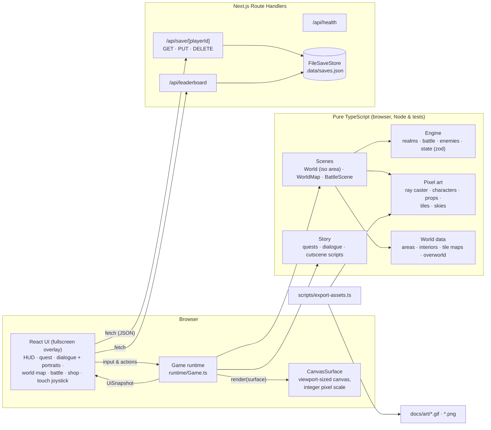

### Game modes

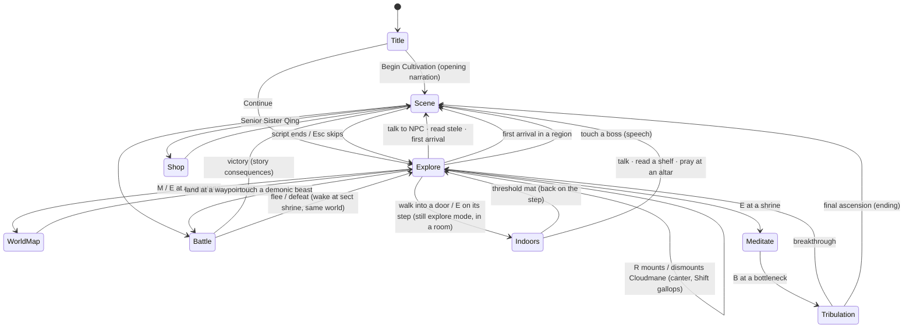

### How a sprite is made

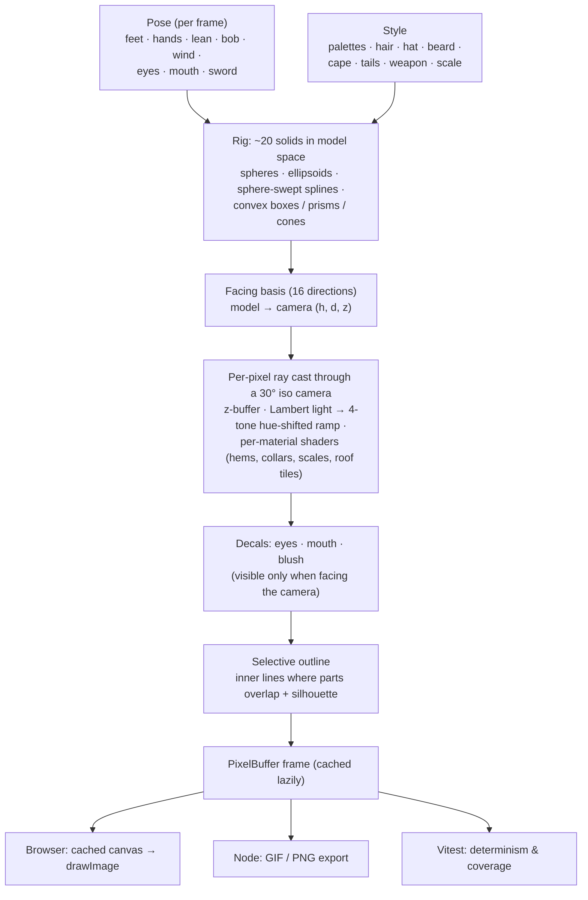

### Isometric renderer

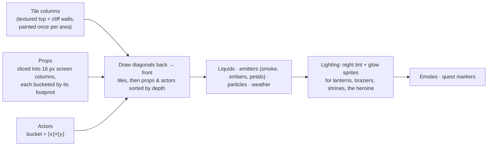

### One battle round

`resolveTurn` is a pure function: it takes the game state, the battle state and an action, and returns the new states plus a list of events. The RNG seed lives in the battle state, so a round always replays the same way. `BattleScene` turns those events into a timeline of dashes, projectiles, lightning and pop-ups on an isometric arena themed after the current region.

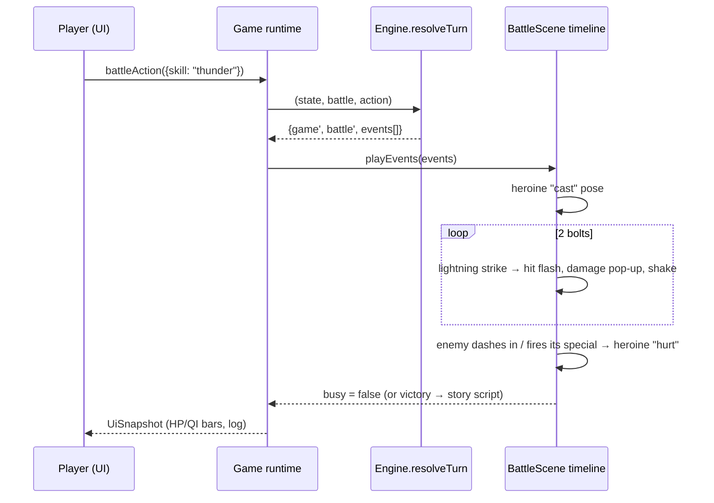

## Testing & CI

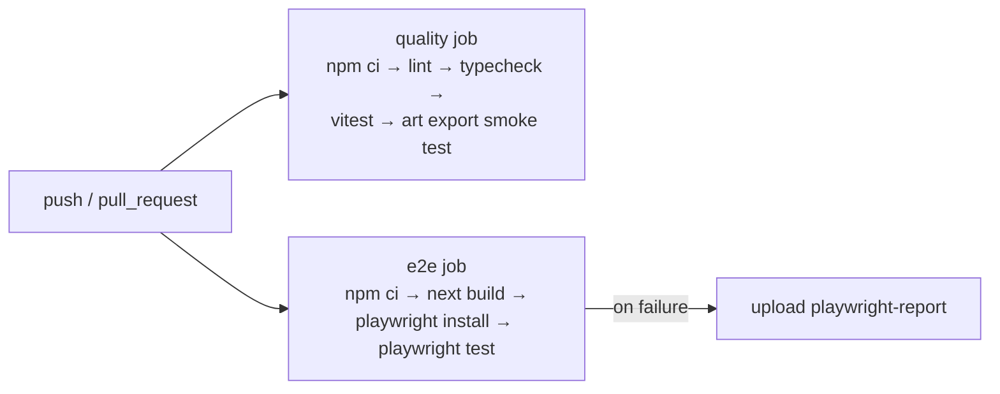

- **Unit tests (Vitest):** the iso projection and ray caster (shading, depth, decal visibility, convex solids), every character × animation × direction, all portraits and props, terrain and skies. Every region layout, and then the whole continuous world, is checked by BFS: every waypoint, NPC, encounter and interactable is reachable on foot, the sky bridges connect, rivers reach the edge, and no prop stands in water or on the road. Also covered: the world map's terrain (built from the real world), save migration from per-region coordinates and from the smaller world, the grown world's size, landmarks and new folk, a complete story walkthrough from prologue to ascension, realms and battle rules, a headless run of the `Game` runtime (cutscenes, walking and collision, tap-to-walk, the elder's briefing, world-map travel, battles won and lost, boss speeches, the fox quest, meditation and tribulation, pickups, rendering every region, walking down the sky bridge into the village, seals turning the heroine back, running, startled cranes, greeting NPCs, respawning beasts, idle fidgets and the day cycle, the wayside folk's gifts, Xiao Han's duel won and lost, landmark banners, beasts sniffing, howling and dozing, opening the map while flying over water, loading a save onto open ground, walking into the Hall of Clouds through its door and back out over the threshold, learning from the archivist, reading the shelves and praying at the altar, every room rendering with its folk at work, losing a fight indoors, a beast standing its ground at the edge of its territory, a lost friendly duel costing nothing, and scripted walks staying at a walk), every room's walls, windows and reachability, every building's door on open ground in front of it, the indoor folk's one-time gifts, and the API route handlers.
- **E2E (Playwright):** fullscreen title and health check, opening narration and walking, walking from the sect into the village in one world, Elder Mo's briefing through to world-map travel, a battle won through the UI, tea and the shop at the crossroads teahouse (with Enter skipping the typewriter text), stepping inside the crossroads teahouse to hear the storyteller and walking back out, a save/reload/continue round trip with the leaderboard, and the gallery canvases painting (now with the indoor folk and every room).

## Project layout

```
src/
  app/                 Next.js App Router: pages (/, /gallery) + API route handlers
  components/          React UI (GameApp, GameView, SpriteGallery, canvas loop hook)
  game/
    pixel/             PixelBuffer, colour, noise, RNG, 3×5 font, Surface abstraction
    iso/               isometric projection + z-buffered pixel-art ray caster
    art/               palettes, humanoid & beast rigs, character registry & portraits,
                       props, terrain tiles, skies
    world/             tile maps, the six region layouts, the world layout,
                       the continuous world builder (continent.ts), the building
                       interiors (interiors.ts), the world map
    story/             cutscene step types, quests, dialogue, scripted scenes
    engine/            realms, enemies, battle, zod save schema (pure)
    runtime/           Game loop, World (open world + battle arenas), WorldMap, BattleScene, particles, title
  server/              save store (atomic JSON file / memory)
tests/                 Vitest unit tests
e2e/                   Playwright specs (+ screenshot capture)
scripts/               GIF/PNG art export
docs/                  screenshots & exported art
```
